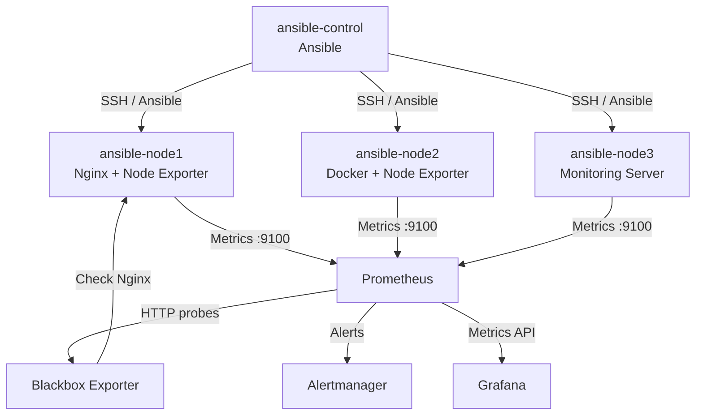

# Ansible Linux Infrastructure Automation

Проект автоматизации развертывания, настройки и сопровождения инфраструктуры Linux-серверов на базе Debian 12 с использованием Ansible.

Реализованы централизованное управление конфигурацией серверов, базовое обеспечение безопасности, развертывание сервисов, мониторинг состояния инфраструктуры, обнаружение отказов, резервное копирование и восстановление конфигурационных файлов.

## Архитектура инфраструктуры

Инфраструктура состоит из управляющего узла Ansible и трёх управляемых серверов.

| Узел | IP-адрес | Назначение |
|---|---|---|
| `ansible-control` | `192.168.56.12` | Управляющий сервер Ansible |
| `ansible-node1` | `192.168.56.13` | Nginx, Node Exporter |
| `ansible-node2` | `192.168.56.14` | Docker, Node Exporter |
| `ansible-node3` | `192.168.56.15` | Prometheus, Grafana, Alertmanager, Blackbox Exporter, Node Exporter |

Управление серверами осуществляется с управляющего узла по SSH с использованием ключевой аутентификации и Ansible Inventory.

### Схема взаимодействия компонентов



## Реализованный функционал

### 1. Базовая настройка и безопасность

Для унификации конфигурации серверов реализованы следующие Ansible-роли:

- `common` — установка необходимых системных пакетов и настройка часового пояса.
- `time_sync` — настройка синхронизации системного времени с использованием Chrony.
- `security_updates` — настройка автоматической установки обновлений безопасности через `unattended-upgrades`.
- `ssh_hardening` — усиление безопасности SSH: отключение входа под root и парольной аутентификации.
- `firewall` — настройка UFW с ограничением входящих подключений.
- `users` — управление пользователями, группами `infra_admins` и `developers`, настройка sudo и SSH-доступа.

### 2. Развертывание сервисов

**Nginx**

На `ansible-node1` развертывается веб-сервер Nginx. Конфигурационные файлы и содержимое веб-страницы управляются Ansible с использованием шаблонов Jinja2.

**Docker**

На `ansible-node2` устанавливаются Docker Engine и Docker Compose. Сервер подготовлен для запуска контейнеризированных приложений.

### 3. Мониторинг и обнаружение отказов

На `ansible-node3` развернут централизованный стек мониторинга.

| Компонент | Назначение |
|---|---|
| Prometheus | Сбор и хранение метрик инфраструктуры |
| Grafana | Визуализация метрик и мониторинговые панели |
| Node Exporter | Сбор системных метрик Linux-серверов |
| Blackbox Exporter | Проверка доступности HTTP-сервисов |
| Alertmanager | Прием и маршрутизация уведомлений о срабатывании правил |

Prometheus собирает метрики с Node Exporter на всех управляемых серверах, а также собственные метрики.

Настроены правила обнаружения следующих событий:

- Недоступность управляемого сервера.
- Загрузка процессора выше 85%.
- Использование оперативной памяти выше 90%.
- Свободное место на корневой файловой системе менее 10%.
- Недоступность HTTP-сервиса Nginx.

Для проверки доступности Nginx используется Blackbox Exporter с HTTP-пробами.

**Проверка отказоустойчивости**

Проведен тест обнаружения отказа веб-сервера:

1. Остановлена служба Nginx на `ansible-node1`.
2. Blackbox Exporter зафиксировал неудачную HTTP-проверку.
3. Prometheus активировал правило `NginxUnavailable`.
4. Сработавший алерт поступил в Alertmanager.
5. После запуска Nginx проверка снова стала успешной, а алерт перешел в неактивное состояние.

Таким образом проверена работа цепочки обнаружения отказа и восстановления сервиса.

### 4. Резервное копирование и восстановление

Реализованы отдельные playbook для резервного копирования и восстановления конфигураций:

- `backup-configs.yml` — сбор конфигурационных файлов с управляемых серверов.
- `restore-config.yml` — восстановление выбранного файла из резервной копии.
- `schedule-backups.yml` — настройка ежедневного запуска резервного копирования через cron.

В резервные копии включены конфигурации SSH, UFW, Nginx, Docker, Prometheus, Alertmanager, Blackbox Exporter и Grafana.

Особенности реализации:

- Резервные копии хранятся на управляющем сервере.
- Для каждого запуска создается каталог с датой резервирования.
- Сохраняется структура каталогов и разделение файлов по именам серверов.
- Для файлов формируется контрольная сумма SHA-256.
- Предусмотрено хранение последних семи поколений резервных копий.
- Перед восстановлением предусмотрено подтверждение операции.
- При восстановлении существующий файл на целевом сервере сохраняется в резервной копии средствами Ansible.

Целостность созданной резервной копии проверяется командой:

```bash
cd backups/2026-11-27
sha256sum -c SHA256SUMS
```

### 5. CI и контроль качества

Для автоматической проверки проекта используется GitHub Actions.

Workflow `.github/workflows/ansible-ci.yml` запускается при push и pull request в ветку `main`.

Выполняются следующие проверки:

- `yamllint` — проверка форматирования YAML.
- `ansible-lint` — статический анализ Ansible-кода.
- `ansible-playbook --syntax-check` — проверка синтаксиса playbook.

Для CI используется `ansible-core 2.17.14`.

## Структура проекта

```text
ansible-linux-automation/
├── .github/
│   └── workflows/
│       └── ansible-ci.yml
├── inventory/
│   ├── group_vars/
│   └── hosts.yml
├── playbooks/
│   ├── site.yml
│   ├── bootstrap-user.yml
│   ├── backup-configs.yml
│   ├── restore-config.yml
│   ├── schedule-backups.yml
│   ├── prometheus.yml
│   ├── grafana.yml
│   ├── alertmanager.yml
│   └── blackbox-exporter.yml
├── roles/
│   ├── common/
│   ├── time_sync/
│   ├── security_updates/
│   ├── ssh_hardening/
│   ├── firewall/
│   ├── users/
│   ├── nginx/
│   ├── docker/
│   ├── node_exporter/
│   ├── prometheus/
│   ├── grafana/
│   ├── alertmanager/
│   └── blackbox_exporter/
├── requirements.yml
├── ansible.cfg
├── .ansible-lint
├── .yamllint
├── .gitignore
└── README.md
```

## Запуск проекта

### Требования

- Управляющий сервер Linux.
- Python 3.
- Ansible.
- SSH-доступ к управляемым серверам.
- Debian 12 на управляемых узлах.
- Настроенная ключевая аутентификация SSH.

### Установка зависимостей

```bash
ansible-galaxy collection install -r requirements.yml
```

### Проверка доступности серверов

```bash
ansible managed_nodes -m ping
```

### Развертывание инфраструктуры

```bash
ansible-playbook playbooks/site.yml
```

Для просмотра предполагаемых изменений без их применения:

```bash
ansible-playbook playbooks/site.yml --check --diff
```

### Отдельное управление компонентами

Развертывание мониторинга:

```bash
ansible-playbook playbooks/prometheus.yml
ansible-playbook playbooks/grafana.yml
ansible-playbook playbooks/alertmanager.yml
ansible-playbook playbooks/blackbox-exporter.yml
```

Резервное копирование:

```bash
ansible-playbook playbooks/backup-configs.yml
```

Настройка расписания:

```bash
ansible-playbook playbooks/schedule-backups.yml
```

Восстановление конфигураций выполняется через `restore-config.yml` с указанием параметров резервной копии и обязательным подтверждением операции. Названия переменных следует смотреть в самом playbook.

## Доступ к Grafana

Grafana настроена на прослушивание локального интерфейса `127.0.0.1:3000` на `ansible-node3`.

Для доступа с управляющего узла можно использовать SSH-туннель:

```bash
ssh -N -i /root/.ssh/ansible_ed25519 \
  -L 192.168.56.12:3000:127.0.0.1:3000 \
  ansible@192.168.56.15
```

После создания туннеля веб-интерфейс доступен по адресу:

```text
http://192.168.56.12:3000
```

## Результаты проекта

В рамках проекта реализованы и проверены:

- Централизованное управление тремя Linux-серверами средствами Ansible.
- Автоматизированная настройка системных параметров и механизмов безопасности.
- Развертывание Nginx и Docker.
- Централизованный сбор системных метрик.
- Мониторинг доступности HTTP-сервисов.
- Обнаружение отказа Nginx с передачей алерта в Alertmanager.
- Восстановление работоспособности сервиса и сброс алерта.
- Резервное копирование конфигураций с контролем целостности SHA-256.
- Восстановление конфигурационных файлов.
- Автоматизированная проверка Ansible-кода через GitHub Actions.

Проект предназначен для демонстрации практических навыков автоматизации Linux-инфраструктуры, управления конфигурациями, мониторинга и базового сопровождения серверных систем.

Инфраструктура развернута в лабораторной виртуальной среде. Конфигурация демонстрирует принципы автоматизации и мониторинга, но не заявляется как готовое промышленное решение.
